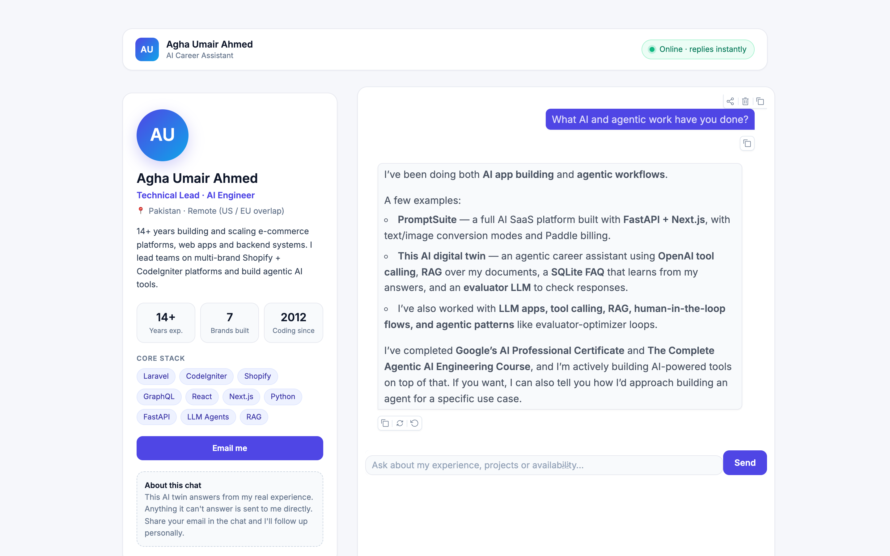
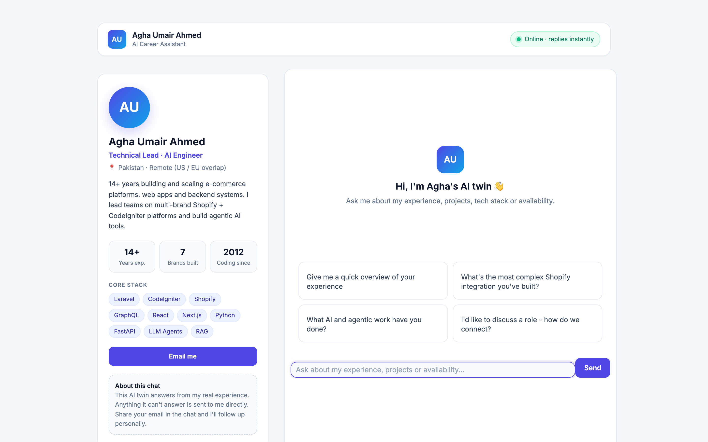
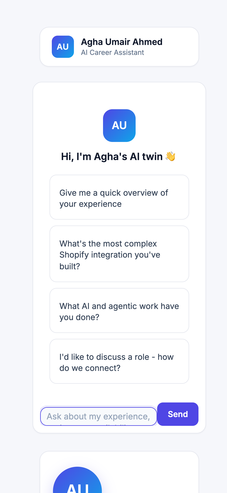
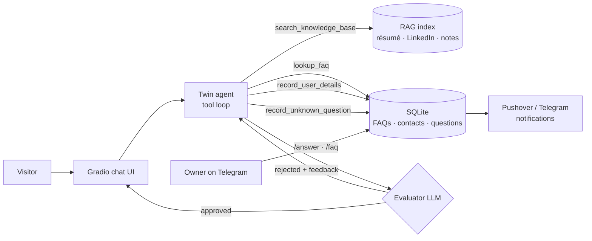

# AI Digital Twin

**An agentic AI assistant that represents you on your website, answering recruiters, hiring managers and clients in your voice, around the clock.**

AI Digital Twin is a production-ready chat agent grounded in your own career data: résumé, LinkedIn profile and knowledge notes. It retrieves facts on demand, checks every answer with a second model before the visitor sees it, captures leads, and learns from you. When it gets a question it can't answer, it notifies you, and your reply on Telegram becomes knowledge it can use from then on.




---

## Screenshots

| Welcome screen | On mobile |
|---|---|
|  |  |

The layout is a profile sidebar (name, title, stats, core stack, contact button) next to a chat panel with suggested questions. On phones the chat moves to the top and the profile becomes compact below it. The interface always renders in its light design, even for visitors whose device is set to dark mode.

---

## Features

- **Bring your own LLM.** Run on OpenAI, Claude, OpenRouter (hundreds of models), Grok, Gemini or a local Ollama model by changing one setting.
- **Agentic RAG.** The model decides when and what to search. A lightweight vector search over Markdown, text and PDF sources (embeddings with NumPy cosine similarity) means no vector database to run. Without an embeddings provider it falls back to BM25-style keyword search.
- **Self-evaluating replies.** Every answer goes through an evaluator–optimizer loop. A second LLM rejects hallucinated, off-brand or unhelpful replies, and the twin regenerates them using that feedback.
- **Lead capture.** When a visitor shares contact details, the twin stores them and notifies you instantly.
- **Human-in-the-loop learning.** Unanswered questions are logged and pushed to you. Answer one from Telegram and it becomes an FAQ the twin uses in future conversations.
- **Telegram owner console.** Review pending questions, answer them, add FAQs, see recent contacts and usage stats from your phone.
- **Real-time notifications** through Pushover and/or Telegram.
- **Polished, responsive UI.** A profile sidebar, a chat panel, suggested questions, and light and dark themes.
- **One-click deployment** to Render, with a ready-made `render.yaml`.

---

## Architecture



### Agent tools

| Tool | Purpose |
|---|---|
| `search_knowledge_base` | Semantic search over your résumé, LinkedIn profile and knowledge notes |
| `lookup_faq` | Finds answers you have already given to similar questions |
| `record_user_details` | Saves a visitor's contact details and notifies you |
| `record_unknown_question` | Logs a question the twin couldn't answer so you can teach it |

### Telegram commands

| Command | Action |
|---|---|
| `/pending` | List unanswered questions |
| `/answer <id> <text>` | Answer a question; it becomes an FAQ |
| `/faq <question> \| <answer>` | Add an FAQ directly |
| `/contacts` | Show the five most recent leads |
| `/stats` | Usage counts |

Only messages from your own `TELEGRAM_CHAT_ID` are accepted.

---

## Getting started

### Prerequisites

- Python 3.12+
- [uv](https://docs.astral.sh/uv/) (or pip)
- An API key for any supported LLM provider (or a local Ollama install)
- Optional: a [Pushover](https://pushover.net) account and/or a Telegram bot

### Installation

```bash
git clone https://github.com/<your-username>/ai-digital-twin.git
cd ai-digital-twin
cp .env.example .env    # add your keys
uv sync
uv run app.py
```

With pip:

```bash
pip install -r requirements.txt
python app.py
```

### Make it yours

| File | What to change |
|---|---|
| `linkedin.pdf` | Export your LinkedIn profile as a PDF |
| `summary.txt` | A short professional summary in your own words |
| `knowledge/*.md` | Extra detail the twin can search: projects, skills, experience |
| `ui.py` → `PROFILE` | Name, title, location, bio, stats, skills and links shown in the sidebar |
| `.env` → `TWIN_NAME` | The name the twin speaks for |

The embeddings cache is rebuilt automatically whenever your source files change.

### Setting up the Telegram console (optional)

1. Message [@BotFather](https://t.me/BotFather), run `/newbot`, and copy the token into `TELEGRAM_BOT_TOKEN`.
2. Send your new bot any message, then open `https://api.telegram.org/bot<TOKEN>/getUpdates` to find your chat ID.
3. Put that ID into `TELEGRAM_CHAT_ID`.

---

## Choose your LLM provider

Set `LLM_PROVIDER` in `.env` and add that provider's key. Nothing else changes.

| Provider | `LLM_PROVIDER` | Key | Default model | Embeddings for RAG |
|---|---|---|---|---|
| OpenAI | `openai` | `OPENAI_API_KEY` | `gpt-5.4-mini` | ✅ built in |
| Anthropic Claude | `anthropic` | `ANTHROPIC_API_KEY` | `claude-opus-5-5` | via OpenAI/OpenRouter key, else keyword search |
| OpenRouter | `openrouter` | `OPENROUTER_API_KEY` | `openai/gpt-5.4-mini` | ✅ built in |
| xAI Grok | `grok` | `XAI_API_KEY` | `grok-4.7` | via OpenAI/OpenRouter key, else keyword search |
| Google Gemini | `gemini` | `GEMINI_API_KEY` | `gemini-2.5-flash` | ✅ built in |
| Ollama (local) | `ollama` | none | `llama3.2` | ✅ `nomic-embed-text` |

**Examples**

```bash
# Claude, directly through Anthropic's official SDK
LLM_PROVIDER=anthropic
ANTHROPIC_API_KEY=sk-ant-...
LLM_MODEL=claude-haiku-5-5        # optional: faster, lower-cost Claude

# Any model through one OpenRouter key: Claude, GPT, Grok, Llama, Mistral...
LLM_PROVIDER=openrouter
OPENROUTER_API_KEY=sk-or-...
LLM_MODEL=anthropic/claude-sonnet-5.5

# Grok
LLM_PROVIDER=grok
XAI_API_KEY=xai-...
```

Under the hood, `llm.py` calls Claude with the official `anthropic` SDK and every other provider through its OpenAI-compatible API. You can also pair models, for example a cheaper model as the quality-control evaluator via `EVALUATOR_PROVIDER` / `EVALUATOR_MODEL`.

---

## Configuration

| Variable | Required | Description |
|---|---|---|
| `LLM_PROVIDER` | | `openai` (default), `anthropic`, `openrouter`, `grok`, `gemini`, `ollama` |
| `LLM_MODEL` | | Override the provider's default model |
| Provider key | ✅ | `OPENAI_API_KEY`, `ANTHROPIC_API_KEY`, `OPENROUTER_API_KEY`, `XAI_API_KEY` or `GEMINI_API_KEY` |
| `EVALUATOR_PROVIDER`, `EVALUATOR_MODEL` | | Use a different model for quality control |
| `EMBEDDINGS_PROVIDER`, `EMBEDDINGS_MODEL` | | Override the embeddings used for RAG |
| `TWIN_NAME` | | Name the twin represents |
| `PUSHOVER_USER`, `PUSHOVER_TOKEN` | | Push notifications |
| `TELEGRAM_BOT_TOKEN`, `TELEGRAM_CHAT_ID` | | Telegram notifications and owner console |
| `TWIN_DB_PATH` | | Custom location for the SQLite database |
| `PORT` | | Server port (set automatically on Render) |

---

## Deployment

The twin is a single container. It listens on `0.0.0.0:$PORT` (default `7860`) and keeps its SQLite database (FAQs, leads, unanswered questions) in `/data`. It is meant to be public, so no login is needed.

### Where to host it

| Platform | Best for | Notes |
|---|---|---|
| **Hugging Face Spaces** | Free, the most common home for Gradio AI apps | Docker Space; add persistent storage to keep the database |
| **Render** | One-click from GitHub | `render.yaml` included; add a disk for `/data` |
| **AWS App Runner** | Managed AWS, no servers | Short chat requests fit well; storage is ephemeral |
| **AWS EC2 / Lightsail** | Full control, persistent data, custom domain | Docker + Caddy for HTTPS (steps below) |
| **Google Cloud Run / Railway / Fly.io** | Pay-per-use containers | Use the same `Dockerfile`; mount a volume for `/data` where supported |

### Run with Docker (any server)

```bash
docker build -t ai-digital-twin .
docker run -d --name twin -p 7860:7860 --env-file .env -v twin-data:/data ai-digital-twin
# open http://localhost:7860
```

### AWS option 1: App Runner (managed, simplest)

1. Push the image to Amazon ECR. On Apple Silicon, build for `linux/amd64`:

   ```bash
   AWS_REGION=us-east-1
   ACCOUNT=$(aws sts get-caller-identity --query Account --output text)
   REPO=$ACCOUNT.dkr.ecr.$AWS_REGION.amazonaws.com/ai-digital-twin

   aws ecr create-repository --repository-name ai-digital-twin --region $AWS_REGION
   aws ecr get-login-password --region $AWS_REGION | docker login --username AWS --password-stdin $ACCOUNT.dkr.ecr.$AWS_REGION.amazonaws.com
   docker buildx build --platform linux/amd64 -t $REPO:latest --push .
   ```

2. In the AWS console, open **App Runner → Create service → Container registry → Amazon ECR** and pick the image.
3. Set the port to **7860** and add your environment variables (`LLM_PROVIDER`, the provider key, Pushover/Telegram). Keep keys in **AWS Secrets Manager** and reference them from App Runner.
4. Deploy. App Runner gives you an HTTPS URL, and you can attach a custom domain.

App Runner's filesystem is not persistent, so the SQLite database resets on each deploy. For permanent FAQs and leads, use option 2.

### AWS option 2: EC2 or Lightsail (persistent, full control)

On an Ubuntu instance (2 GB RAM is enough) with ports 80 and 443 open:

```bash
sudo apt-get update && sudo apt-get install -y docker.io git caddy
git clone https://github.com/<your-username>/ai-digital-twin.git && cd ai-digital-twin
nano .env                                   # LLM_PROVIDER, keys, notifications
sudo docker build -t ai-digital-twin .
sudo docker run -d --restart unless-stopped --name twin \
  -p 127.0.0.1:7860:7860 --env-file .env -v twin-data:/data ai-digital-twin

# Free HTTPS for your domain (point an A record at the instance first)
echo 'twin.yourdomain.com {
  reverse_proxy 127.0.0.1:7860
}' | sudo tee /etc/caddy/Caddyfile
sudo systemctl reload caddy
```

To update later: `git pull`, rebuild, then `docker rm -f twin` and run the same `docker run` command. The `twin-data` volume keeps your data.

### Hugging Face Spaces

1. Create a new Space with **SDK: Docker** (it serves port 7860 by default).
2. Push this repository to the Space. The Space's `README.md` must start with this header:

   ```yaml
   ---
   title: AI Digital Twin
   sdk: docker
   app_port: 7860
   ---
   ```

3. Add your keys under **Settings → Variables and secrets**.
4. To keep the database between restarts, enable persistent storage (it mounts at `/data`).

### Render

The repository includes a `render.yaml` blueprint:

1. Push this repository to GitHub.
2. In Render, choose **New → Blueprint** and select the repository.
3. Fill in the secret environment variables when prompted.

On Render the filesystem is ephemeral unless you attach a disk. Point `TWIN_DB_PATH` at the disk (for example `/data/twin.db`) to keep FAQs and leads.

---

## Project structure

```
├── app.py            # entry point: agent loop + evaluator-optimizer
├── llm.py            # provider layer: OpenAI, Claude, OpenRouter, Grok, Gemini, Ollama
├── context.py        # loads profile sources and builds the system prompt
├── knowledge.py      # chunking, embeddings (or keyword fallback), cached search
├── tools.py          # tool functions, JSON schemas, safe dispatcher
├── evaluator.py      # quality-control LLM with structured output
├── database.py       # SQLite: FAQs, unknown questions, contacts
├── notifier.py       # Pushover + Telegram notifications
├── telegram_bot.py   # owner console (long-polling, owner-only)
├── ui.py             # profile sidebar + chat layout
├── styles.py         # theme, CSS and JS
├── knowledge/        # Markdown knowledge notes
├── summary.txt       # professional summary
├── linkedin.pdf      # LinkedIn profile export
├── docs/screenshots/ # images used in this README
├── Dockerfile        # container image for any host (AWS, Spaces, Cloud Run...)
└── render.yaml       # Render deployment blueprint
```

---

## Tech stack

**OpenAI SDK** and **Anthropic SDK** (chat, tool use, structured outputs, embeddings) · **OpenRouter / xAI / Gemini / Ollama** · **Gradio 6** · **NumPy** · **SQLite** · **pypdf** · **Pydantic** · **Telegram Bot API** · **Pushover** · **Render**

---

## License

Released under the MIT License.
