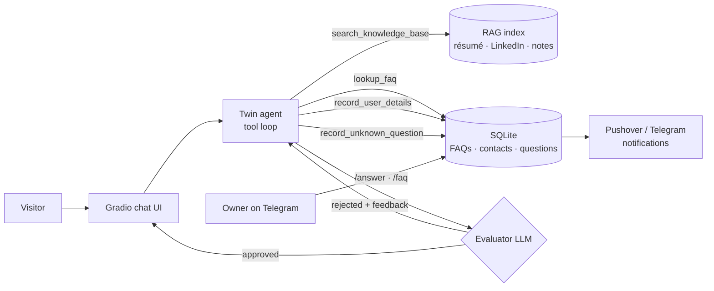

# AI Digital Twin

**An agentic AI assistant that represents you on your website, answering recruiters, hiring managers and clients in your voice, around the clock.**

AI Digital Twin is a production-ready chat agent grounded in your own career data: résumé, LinkedIn profile and knowledge notes. It retrieves facts on demand, checks every answer with a second model before the visitor sees it, captures leads, and learns from you. When it gets a question it can't answer, it notifies you, and your reply on Telegram becomes knowledge it can use from then on.


---

## Features

- **Agentic RAG.** The model decides when and what to search. A lightweight vector search over Markdown, text and PDF sources (OpenAI embeddings with NumPy cosine similarity) means no vector database to run.
- **Self-evaluating replies.** Every answer goes through an evaluator–optimizer loop. A second LLM rejects hallucinated, off-brand or unhelpful replies, and the twin regenerates them using that feedback.
- **Lead capture.** When a visitor shares contact details, the twin stores them and notifies you instantly.
- **Human-in-the-loop learning.** Unanswered questions are logged and pushed to you. Answer one from Telegram and it becomes an FAQ the twin uses in future conversations.
- **Telegram owner console.** Review pending questions, answer them, add FAQs, see recent contacts and usage stats from your phone.
- **Real-time notifications** through Pushover and/or Telegram.
- **Polished, responsive UI.** A profile sidebar, a chat panel, suggested questions, and light and dark themes.
- **One-click deployment** to Render, with a ready-made `render.yaml`.

---

## Architecture



### Agent tools

| Tool | Purpose |
|---|---|
| `search_knowledge_base` | Semantic search over your résumé, LinkedIn profile and knowledge notes |
| `lookup_faq` | Finds answers you have already given to similar questions |
| `record_user_details` | Saves a visitor's contact details and notifies you |
| `record_unknown_question` | Logs a question the twin couldn't answer so you can teach it |

### Telegram commands

| Command | Action |
|---|---|
| `/pending` | List unanswered questions |
| `/answer <id> <text>` | Answer a question; it becomes an FAQ |
| `/faq <question> \| <answer>` | Add an FAQ directly |
| `/contacts` | Show the five most recent leads |
| `/stats` | Usage counts |

Only messages from your own `TELEGRAM_CHAT_ID` are accepted.

---

## Getting started

### Prerequisites

- Python 3.12+
- [uv](https://docs.astral.sh/uv/) (or pip)
- An OpenAI API key
- Optional: a [Pushover](https://pushover.net) account and/or a Telegram bot

### Installation

```bash
git clone https://github.com/<your-username>/ai-digital-twin.git
cd ai-digital-twin
cp .env.example .env    # add your keys
uv sync
uv run app.py
```

With pip:

```bash
pip install -r requirements.txt
python app.py
```

### Make it yours

| File | What to change |
|---|---|
| `linkedin.pdf` | Export your LinkedIn profile as a PDF |
| `summary.txt` | A short professional summary in your own words |
| `knowledge/*.md` | Extra detail the twin can search: projects, skills, experience |
| `ui.py` → `PROFILE` | Name, title, location, bio, stats, skills and links shown in the sidebar |
| `.env` → `TWIN_NAME` | The name the twin speaks for |

The embeddings cache is rebuilt automatically whenever your source files change.

### Setting up the Telegram console (optional)

1. Message [@BotFather](https://t.me/BotFather), run `/newbot`, and copy the token into `TELEGRAM_BOT_TOKEN`.
2. Send your new bot any message, then open `https://api.telegram.org/bot<TOKEN>/getUpdates` to find your chat ID.
3. Put that ID into `TELEGRAM_CHAT_ID`.

---

## Configuration

| Variable | Required | Description |
|---|---|---|
| `OPENAI_API_KEY` | ✅ | OpenAI API key |
| `TWIN_NAME` | | Name the twin represents |
| `TWIN_MODEL` | | Chat model (default `gpt-5.4-mini`) |
| `PUSHOVER_USER`, `PUSHOVER_TOKEN` | | Push notifications |
| `TELEGRAM_BOT_TOKEN`, `TELEGRAM_CHAT_ID` | | Telegram notifications and owner console |
| `TWIN_DB_PATH` | | Custom location for the SQLite database |
| `PORT` | | Server port (set automatically on Render) |

---

## Deployment

### Render

The repository includes a `render.yaml` blueprint:

1. Push this repository to GitHub.
2. In Render, choose **New → Blueprint** and select the repository.
3. Fill in the secret environment variables when prompted.

On Render's free plan the filesystem is ephemeral, so the SQLite database resets on redeploy. Point `TWIN_DB_PATH` at a persistent disk to keep FAQs and leads.

---

## Project structure

```
├── app.py            # entry point: agent loop + evaluator-optimizer
├── context.py        # loads profile sources and builds the system prompt
├── knowledge.py      # chunking, embeddings, cached cosine-similarity search
├── tools.py          # tool functions, JSON schemas, safe dispatcher
├── evaluator.py      # quality-control LLM with structured output
├── database.py       # SQLite: FAQs, unknown questions, contacts
├── notifier.py       # Pushover + Telegram notifications
├── telegram_bot.py   # owner console (long-polling, owner-only)
├── ui.py             # profile sidebar + chat layout
├── styles.py         # theme, CSS and JS
├── knowledge/        # Markdown knowledge notes
├── summary.txt       # professional summary
├── linkedin.pdf      # LinkedIn profile export
└── render.yaml       # Render deployment blueprint
```

---

## Tech stack

**OpenAI** (chat, embeddings, structured outputs) · **Gradio 6** · **NumPy** · **SQLite** · **pypdf** · **Pydantic** · **Telegram Bot API** · **Pushover** · **Render**

---

## License

Released under the MIT License.
